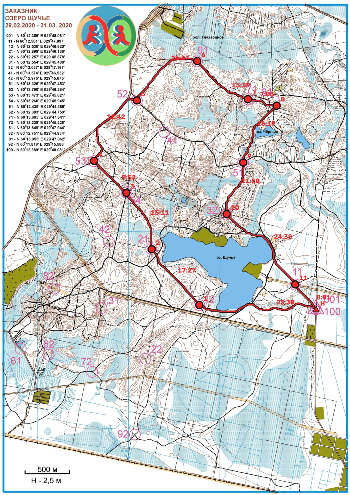

# rogaine-planner



[](https://github.com/Dmkdok/rogaine-planner/actions/workflows/tests.yml)

Локальный офлайн-инструмент, который строит маршрут с подсчётом очков по растровой карте рогейна
(соревнования по ориентированию на заданное количество очков). Он классифицирует местность по
цветам ISOM, находит фиолетовые и красные кружки КП, рассчитывает для заданной скорости бегуна
поле времени прохождения каждого пикселя и точное время между КП, а затем решает задачу
ориентирования (Orienteering Problem): набрать максимум очков за отведённое время, вернувшись
на старт; за опоздание начисляется штраф за каждую минуту. В проект входят интерфейс командной
строки на Python (`rogaine`) и локальный веб-просмотрщик.

Полные требования и описание архитектуры: [docs/SPEC.md](docs/SPEC.md), [docs/PLAN.md](docs/PLAN.md),
[docs/DECISIONS.md](docs/DECISIONS.md).

## Установка

Поддерживаемая среда запуска — Docker (ADR-004): образ использует Python 3.12 и включает
`tesseract-ocr`, а также нативные библиотеки OpenCV и scipy. Установка непосредственно на хост
возможна, но официально не поддерживается.

```bash
docker compose build
```

Из одного `Dockerfile` собираются два образа: `rogaine-planner:base` (приложение, сервис `app`)
и `rogaine-planner:test` (с pytest/ruff/Playwright, сервис `tests`).

### Установка на хосте (не рекомендуется)

```bash
pip install -e ".[dev]"
```

Требуется Python >=3.12 и установленный в системе исполняемый файл `tesseract-ocr` в `PATH` для
распознавания номеров КП (`pytesseract` только вызывает его, но не включает в себя). В Windows
сам `pytest` зависает — на любой ОС всегда запускайте тесты командой
`docker compose run --rm tests`.

## Быстрый старт

```bash
docker compose run --rm app rogaine plan \
  --map data/maps/example/map.png --scale 10000 --dpi 300 \
  --limit 4h --speed 2.0 --out-dir out
```

Команда создаёт `out/route.json` и `out/route.png`, а также выводит в терминал описание каждого
участка маршрута и несколько лучших альтернатив. Вызов `docker compose run --rm app` заменяет
команду сервиса `app` по умолчанию (`rogaine serve`, см. [Веб-интерфейс](#веб-интерфейс)), поэтому
любую команду `rogaine …` можно запускать таким способом. Весь репозиторий подключён как том
(`./:/app`), поэтому пути в `data/`, `config/` и выбранном `--out-dir` совпадают на хосте и в
контейнере.

## Команды CLI

Для переопределения [`config/default.toml`](config/default.toml) каждая команда принимает
`--config <path>` (или `$ROGAINE_CONFIG`); подробности — в разделе
[Справочник по конфигурации](#справочник-по-конфигурации).

### `rogaine segment`

Классифицирует растровую карту по классам местности ISOM и сохраняет `terrain.npz` (метки и
плотность горизонталей) и `terrain_preview.png`.

| Флаг | По умолчанию | Описание |
|---|---|---|
| `--map` | *(обязательно)* | Растровая карта или PDF. |
| `--dpi` | определяется по файлу / конфигурации | Разрешение скана. |
| `--scale` | — | Знаменатель масштаба карты `N` в формате `1:N`; используется вместе с `--dpi` (SPEC F2). |
| `--calibrate` | — | Калибровка по двум точкам `x1,y1,x2,y2,meters` вместо `--scale` (SPEC F3). |
| `--page` | `0` | Страница PDF, нумерация с нуля; для других форматов не используется. |
| `--out-dir` | `.` | Каталог для `terrain.npz` и `terrain_preview.png`. |

Нужно указать ровно один из параметров: `--scale` или `--calibrate`.

### `rogaine detect`

Находит стартовый и контрольные кружки, распознаёт номера с помощью OCR и создаёт CSV с КП,
который можно редактировать.

| Флаг | По умолчанию | Описание |
|---|---|---|
| `--map` | *(обязательно)* | Растровая карта или PDF. |
| `--dpi` | определяется по файлу / конфигурации | Разрешение скана. |
| `--out` | `controls.csv` | Путь к выходному CSV (формат описан ниже). |

Если стартовый/финишный кружок не найден, команда завершается с кодом 1. Неразборчивые номера КП
записываются с пустым значением `points` и отмечаются предупреждением — система не пытается
угадать номер (SPEC F8, ADR-009).

### `rogaine plan`

Полный конвейер: определяет КП (или пропускает поиск при заданном `--controls` с CSV, изменённым
вручную), строит поле стоимости и матрицу времени между КП, решает задачу, выводит маршрут и
альтернативы, сохраняет `route.json` и `route.png`.

| Флаг | По умолчанию | Описание |
|---|---|---|
| `--map` | *(обязательно)* | Растровая карта или PDF. |
| `--dpi` | определяется по файлу / конфигурации | Разрешение скана. |
| `--scale` / `--calibrate` | — | Как и в `segment`, требуется ровно один параметр. |
| `--controls` | — | Подготовленный вручную файл `controls.csv`; полностью пропускает поиск КП (SPEC F9). |
| `--speed` | `2.0` | Базовая скорость бегуна по дороге, м/с. |
| `--limit` | `4h` | Лимит времени: `4h`, `2h30m`, `90s` или число секунд. |
| `--penalty-per-min` | `1.0` | Штраф в очках за каждую минуту сверх лимита. |
| `--strategy` | `auto` | `auto` \| `exact` \| `heuristic`. В режиме `auto` точный метод выбирается при числе КП не больше `exact_max_controls`. |
| `--heuristic-time-budget` | `30.0` | Лимит времени работы эвристического решателя, секунды. |
| `--alternatives` | `3` | Число структурно различных альтернативных маршрутов (максимум 20). |
| `--seed` | `0` | Начальное значение для эвристики и поиска альтернатив (обеспечивает воспроизводимость, SPEC F19). |
| `--out-dir` | `.` | Каталог для `route.json` и `route.png`. |

Команда завершается с кодом 1 и ничего не записывает, если не найден стартовый кружок или в
пределах лимита времени нет достижимых КП. На диск попадает только успешно рассчитанный маршрут.

### `rogaine bench`

Проверяет корректность эвристического решателя: запускает точный и эвристический методы на одном
небольшом синтетическом примере и выводит разницу в очках (целевой порог SPEC F13 — не более 5%).
Всегда завершается с кодом 0: команда только выводит результат и не блокирует работу.

| Флаг | По умолчанию | Описание |
|---|---|---|
| `--n-candidates` | `10` | КП-кандидаты в синтетическом примере (старт не учитывается). Ограничено значением `config.solver.exact_max_controls`. |
| `--seed` | `0` | Начальное значение для генерации примера и генератора случайных чисел эвристики. |
| `--time-budget` | `2.0` | Лимит времени работы эвристического решателя, секунды. |

### `rogaine serve`

Запускает сервер веб-просмотрщика на FastAPI (uvicorn).

| Флаг | По умолчанию | Описание |
|---|---|---|
| `--host` | `127.0.0.1` | Адрес для прослушивания. Не задавайте `0.0.0.0` непосредственно на хосте: сервис `app` использует этот адрес внутри контейнера, а `docker-compose.yml` публикует порт только на `127.0.0.1:8001`. |
| `--port` | `8000` | Порт сервера. |

### `rogaine corpus list` / `rogaine corpus check <id>`

Проверяют содержимое `data/maps/`. Структура корпуса описана в [data/README.md](data/README.md)
(`meta.toml`, `controls.csv`, `reference.json`). Команда `list` не завершается ошибкой при неполной
карте, а сообщает, чего не хватает; `check <id>` завершится с кодом 1, если выбранная карта не
готова к построению маршрута. Обе команды принимают `--root` (по умолчанию `data/maps`).

### Глобальные параметры

`--version` выводит версию и завершает работу. Если запустить `rogaine` без подкоманды, будет
показана справка.

## Веб-интерфейс

```bash
docker compose up app
```

Откройте http://localhost:8001. Загрузите файл карты, задайте масштаб (1:N и DPI либо длину
отрезка калибровки в метрах), проверьте и отредактируйте найденные КП, укажите лимит времени,
скорость и штраф, нажмите «Запустить». Затем можно изучить маршрут поверх карты и таблицу
участков, а также экспортировать JSON, PNG и CSV.

Для каждой сессии браузера сервер создаёт `run_id` (UUID); результаты каждого этапа сохраняются
в `runs/<run_id>/`, поэтому следующие этапы (поиск КП и построение маршрута) могут использовать их
повторно. Файлы доступны через `GET /api/runs/{id}/export/{route.json,route.png,controls.csv}`.
Задания (`segment`/`detect`/`plan`) выполняются в фоне, статус проверяется через
`GET /api/jobs/{job_id}`. Этот интерфейс использует тот же конвейер, что и CLI, и не заменяет
создаваемые CLI файлы в `--out-dir` (SPEC F17). Тип загруженного файла определяется по сигнатуре,
а размер ограничен 200 МБ; имя файла и `Content-Type`, переданные клиентом, не считаются
достоверными.

## Справочник по конфигурации

Все настраиваемые параметры находятся в одном TOML-файле [`config/default.toml`](config/default.toml)
(SPEC F18). В нём есть подробные комментарии и ссылки на источник значений (IOF ISOM 2017-2 /
Appendix 1 либо измерения на конкретном реальном скане). Указать другой файл можно через
`--config my.toml` (достаточно перечислить изменяемые ключи — настройки будут объединены с
поставляемыми по умолчанию) или `$ROGAINE_CONFIG`. Параметры CLI (`--speed`, `--limit`,
`--alternatives` и другие) имеют приоритет для соответствующего запуска.

При загрузке проверяется, что конфигурация точно соответствует описанию классов местности в
`models.py`: отсутствие класса или неизвестный ключ (для всех таблиц действует `extra="forbid"`)
приведут к немедленной ошибке.

| Раздел | Назначение |
|---|---|
| `[map]` | DPI по умолчанию, если он не указан ни в растре, ни пользователем. |
| `[palette]` / `[palette.ink]` / `[[palette.shade]]` | Порог классификации CIELAB, радиус заполнения неизвестных областей, шесть печатных красок ISOM (CMYK) и все полученные из них оттенки (краска и процент растискивания). |
| `[[terrain]]` (17 записей) | Строка для каждого `TerrainClass`: код символа ISOM, оттенок, `speed_factor` (доля скорости по дороге), `passable` (проходимость). |
| `[grid]` | Пороговые значения формы, предотвращающие ошибочную классификацию линий сетки, магнитного севера и рамки как воды (ADR-012, SPEC F20). |
| `[linear]` | Номинальная ширина дорог, троп и дорожек на отпечатанной карте; геометрические фильтры (вытянутость, соотношение сторон, минимальная длина) разделяют общий класс-заглушку `road` с чёрной краской на три линейных класса. |
| `[slope]` | Сигма размытия плотности горизонталей и зависящий от неё штраф к скорости (это приближение крутизны, а не высоты — ADR-006). |
| `[detector]` | Геометрия и допуск для контрольных кружков; диапазоны оттенков (`ink_hue_ranges` для фиолетового, `red_hue_ranges` с более строгими порогами насыщенности/яркости/разницы каналов для красного, ADR-011/ADR-018); параметры Хафа; множители масштаба для крупных кружков, нарисованных вручную (ADR-015); область OCR для номера и правило начисления очков (`first_digit` / `constant` / `csv`). |
| `[graph]` | Коэффициент уменьшения сетки и множитель стоимости непроходимой местности. |
| `[solver]` | Выбор решателя и предельное число КП для точного метода, лимит времени и параметры GRASP для эвристики, начальное значение, число альтернатив. |
| `[rules]` | Штраф по умолчанию за каждую минуту опоздания. |

## Формат JSON маршрута

`route.json` (создаётся командами `plan` и `plan` веб-просмотрщика; схема описана в
[`src/rogaine/io/route_json.py`](src/rogaine/io/route_json.py)):

```json
{
  "schema_version": 1,
  "order": [0, 3, 0],
  "legs": [
    {
      "from_id": 0, "to_id": 3,
      "seconds": 612.4, "meters": 1180.0,
      "polyline": [[1600, 1200], [1580, 1150]],
      "cumulative_seconds": 612.4
    },
    {
      "from_id": 3, "to_id": 0,
      "seconds": 598.1, "meters": 1150.0,
      "polyline": [[1580, 1150], [1600, 1200]],
      "cumulative_seconds": 1210.5
    }
  ],
  "total_seconds": 13920.0,
  "total_meters": 26400.0,
  "points": 38,
  "penalty": 0.0,
  "score": 38.0,
  "solver": "exact",
  "optimal": true,
  "seed": 0,
  "run_config": {
    "base_speed_mps": 2.0, "time_limit_s": 14400.0, "penalty_per_min": 1.0,
    "strategy": "auto", "heuristic_time_budget_s": 30.0, "alternatives": 3, "seed": 0
  }
}
```

- `order` — идентификаторы КП в порядке посещения; маршрут всегда начинается и заканчивается на старте.
- `legs` — участок для каждой пары соседних КП в `order`; `polyline` — пиксельные координаты `(x, y)` фактического пути; `cumulative_seconds` — время от старта к концу этого участка.
- `solver` — `"exact"` (алгоритм Хелда — Карпа, гарантирует оптимум до `exact_max_controls`) или `"heuristic"` (GRASP и локальный поиск); `optimal` равно `true` только для первого метода (ADR-003).
- `run_config` — точная конфигурация `RunConfig`, использованная для построения маршрута (скорость, лимит, штраф, метод и начальное значение); она включена в файл, чтобы `route.json` содержал все сведения о запуске.
- `schema_version` — номер версии для будущих несовместимых изменений формата; сейчас `1`.

`route.png` — маршрут, нанесённый на исходную карту; номера КП соответствуют JSON.

КП можно импортировать и экспортировать в CSV (`id,x,y,number,points,confidence,source,is_hub`)
без потери данных. Формат и правила ручного редактирования описаны в [data/README.md](data/README.md).

## Известные ограничения

- **Распознавание OCR не является критически важным.** Tesseract пытается распознать номера КП,
  но неразборчивый номер записывается как `points: null` и отмечается предупреждением, а не
  угадывается. Для надёжного результата используйте правило начисления очков (`first_digit` по
  умолчанию) или вручную отредактируйте CSV с КП (ADR-009).
- **Плотность горизонталей — это приближение крутизны, а не реальная высота.** Она не позволяет
  отличить подъём от спуска, поэтому стоимость маршрута не зависит от направления (ADR-006).
- **Обработка линий сетки/рамки и цвета КП настроена по небольшому набору реальных сканов**, а не
  рассчитана на все случаи. Эвристики формы и оттенка (`[grid]`, `[detector].ink_hue_ranges`,
  ADR-011, ADR-012) основаны на замерах, указанных в комментариях `config/default.toml`, и могут
  потребовать перенастройки для другого принтера или сканера.
- **Для более чем `exact_max_controls` (15) КП нельзя проверить оптимальность эвристики.** Команда
  `bench` показывает измеренную разницу, когда точный решатель ещё применим; для 30–80 КП продукт
  не заявляет об оптимальности, а сообщает только целевую функцию и доступную оценку разницы.
- **Классификация палитры рассчитана на скан или отрисовку, а не на фотографию телефона.**
  Нормализация баланса белого и освещения помогает, но не заменяет контролируемое освещение.
  Опциональный этап SegFormer (M7, по умолчанию не собирается; см. `docs/TASKS.md`) предназначен
  для этого случая и обучается на масках палитры, но не входит в доступный CLI/веб-конвейер.
- **Нет геопривязки по GPS, экспорта GPX/GeoTIFF и автоматического определения масштабной линейки.**
  Масштаб всегда задаётся пользователем (`--scale` и `--dpi` либо `--calibrate`).
- **Нет обнаружения КП с помощью VLM** (в статье-источнике используется Yandex Cloud Qwen):
  поиск полностью основан на классическом компьютерном зрении (кружки Хафа, фильтры цвета и формы).
- **Нет моделирования усталости или изменения скорости во времени** — одна `base_speed_mps`
  масштабирует скорость для всех типов местности на всём маршруте.
- **Бинарная векторная геометрия `.ocd` (OCAD) не разбирается.** Поддерживаются только растры,
  в том числе растры, экспортированные из OCAD.
- **Один пользователь, один процесс; данные хранятся только в локальных каталогах запусков.**
  Реестр заданий веб-просмотрщика находится в памяти и теряется при перезапуске; на диске
  сохраняются каталоги `runs/<uuid>/`.

## Разработка

```bash
docker compose run --rm tests            # весь набор тестов (pytest зависает в Windows — всегда запускайте в Docker)
docker compose run --rm tests ruff check .
docker compose run --rm tests pytest -m "not perf and not corpus"   # без медленных тестов и тестов с корпусом карт владельца
```

Маркеры тестов (`pyproject.toml`): `perf` (медленные проверки производительности), `e2e`
(сквозные сценарии CLI/Playwright), `corpus` (нужен корпус реальных карт владельца в `data/maps`,
ADR-010).

Документация проекта: [docs/SPEC.md](docs/SPEC.md) (требования), [docs/PLAN.md](docs/PLAN.md)
(архитектура и структура файлов), [docs/TASKS.md](docs/TASKS.md) (открытые задачи),
[docs/DECISIONS.md](docs/DECISIONS.md) (ADR), [docs/STATUS.md](docs/STATUS.md) (передача контекста).
